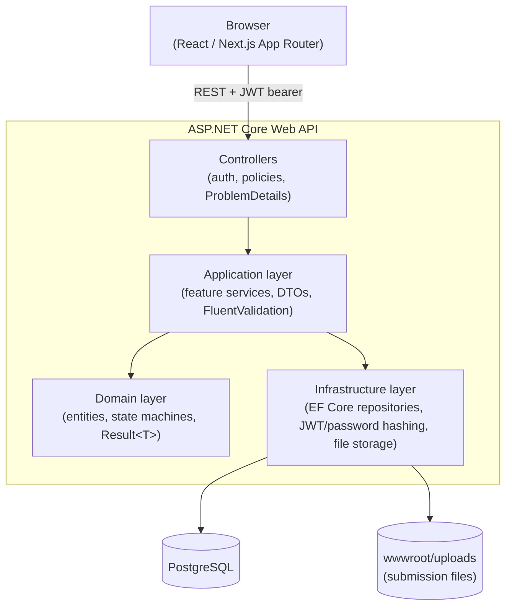
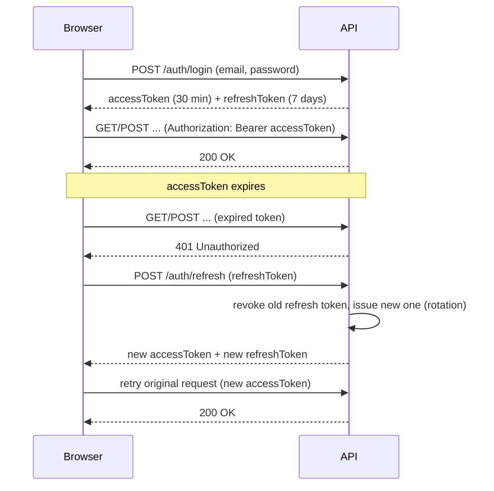
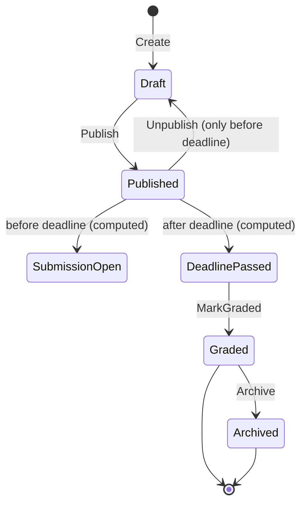
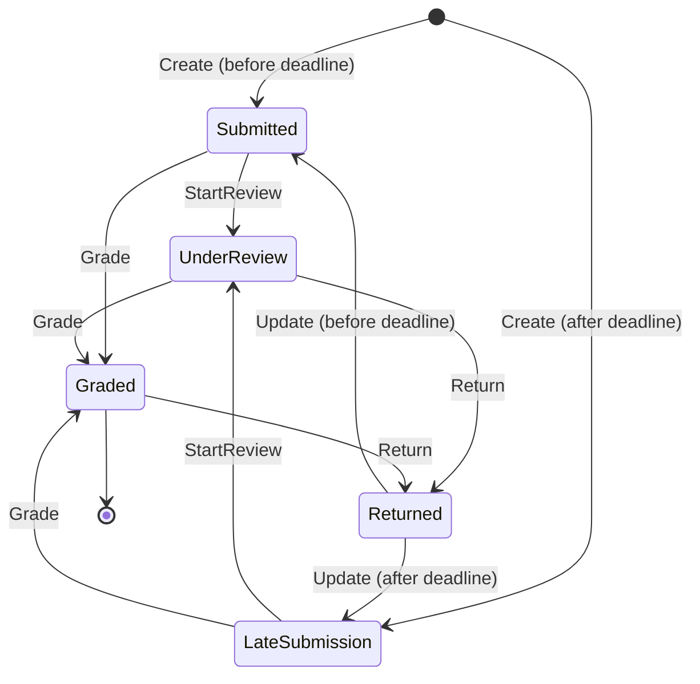

# Assignment & Submission Management System

A role-based Assignment & Submission Management System for a school or college. Teachers create, publish, and
grade assignments for a specific class and subject; students submit (and, before the deadline or while
returned for revision, update) their answers with an optional file attachment; teachers review submissions,
record marks and feedback, and close out an assignment once grading is complete. Admins manage users, classes,
subjects, and teacher assignments, and have system-wide visibility.

## Main Features

**Admin**
- Manage users (create, update, activate/deactivate, list/filter by role).
- Manage classes and subjects.
- Assign teachers to a subject within a class, and manage student enrollments.
- View all assignments and submissions across the system.
- System-wide dashboard (user/class/assignment/submission counts).

**Teacher**
- Create, update, and delete assignments for a class/subject they are assigned to teach.
- Drive an assignment through its full lifecycle: publish, unpublish (before the deadline), mark graded (after
  the deadline), and archive — see [Assignment Lifecycle](#assignment-lifecycle) below. Editing is blocked once
  an assignment is graded or archived.
- View submissions for their own assignments, download attached files, start a review, grade, or return a
  submission for revision.
- Teacher dashboard (own assignments, pending submissions to grade, etc.).

**Student**
- View assignments for the classes they are enrolled in (drafts stay hidden until published).
- Submit an answer, optionally with a PDF/DOCX/ZIP attachment (max 20 MB); submissions made after the deadline
  are still accepted but flagged `LateSubmission` rather than rejected outright.
- Update a submission while it's still editable (see [Submission Lifecycle](#submission-lifecycle)), and
  download their own attached file back.
- View submission status, marks, and teacher feedback.
- Student dashboard (upcoming deadlines, submission history).

**Cross-cutting**
- JWT access + refresh token authentication, with rotation on every refresh (the old refresh token is revoked
  as soon as a new one is issued) and role-based + resource-ownership authorization enforced on every endpoint.
- Real file upload for submission attachments (PDF/DOCX/ZIP, size- and extension-validated server-side), stored
  on disk and served back only to the owning student, the assignment's teacher, or an admin.
- Server-side validation (FluentValidation) and a consistent error response shape (RFC 7807 Problem Details).
- Structured logging (Serilog) and a global exception handler for unhandled errors.
- Swagger/OpenAPI documentation with JWT bearer auth wired in, available in Development.
- One-command local startup via Docker Compose (Postgres + API + frontend).

## Technology Stack

| Layer | Technology |
|---|---|
| Frontend | Next.js (App Router), React, TypeScript, TanStack Query, React Hook Form + Zod, Tailwind CSS |
| Backend | ASP.NET Core Web API (.NET 10), C# |
| Database | PostgreSQL, EF Core (code-first migrations) |
| Auth | JWT bearer access tokens + refresh tokens (rotation on use), ASP.NET Core policy-based authorization |
| Validation | FluentValidation |
| Logging | Serilog |
| File storage | Local disk (`wwwroot/uploads`) behind an `IFileStorageService` abstraction |
| Testing | xUnit, FluentAssertions (backend, 94 tests); EF Core InMemory / SQLite for test doubles |
| Containerization | Docker, Docker Compose |

## Architecture



The backend follows a layered/DDD-style architecture (Domain → Application → Infrastructure → Api). Each
Application feature folder (`Features/<Feature>/`) contains `Service/` (interface + implementation, one method
per use case), `Dto/` (response DTOs + entity-to-DTO mapping), and `Inputs/` (request records + FluentValidation
validators). Controllers call the feature service directly — there is no CQRS/mediator layer. Data access is
abstracted through a generic `IRepository<TEntity>` (implemented once, inherited per entity) plus a single
`IUnitOfWork.SaveChangesAsync`, rather than services depending on the DbContext directly.

## Database (ER Diagram)

```mermaid
erDiagram
    USER {
        guid Id
        string Email
        string PasswordHash
        string FullName
        enum Role
        bool IsActive
    }
    CLASS {
        guid Id
        string Name
        string Description
    }
    SUBJECT {
        guid Id
        string Name
        string Description
    }
    CLASS_SUBJECT {
        guid ClassId
        guid SubjectId
    }
    TEACHER_ASSIGNMENT {
        guid TeacherUserId
        guid ClassId
        guid SubjectId
    }
    STUDENT_ENROLLMENT {
        guid StudentUserId
        guid ClassId
    }
    ASSIGNMENT {
        guid Id
        string Title
        string Description
        guid ClassId
        guid SubjectId
        guid TeacherUserId
        datetime DeadlineUtc
        int MaxMarks
        enum Status
        bool IsDeleted
    }
    SUBMISSION {
        guid Id
        guid AssignmentId
        guid StudentUserId
        string Content
        string FileName
        string StoredFileName
        string FileContentType
        long FileSizeBytes
        datetime SubmittedAtUtc
        bool IsLate
        enum Status
        int Marks
        string Feedback
        datetime GradedAtUtc
        guid GradedByUserId
    }
    REFRESH_TOKEN {
        guid Id
        guid UserId
        string TokenHash
        datetime ExpiresAtUtc
        datetime RevokedAtUtc
    }

    USER ||--o{ REFRESH_TOKEN : "has"
    USER ||--o{ TEACHER_ASSIGNMENT : "teaches (Teacher)"
    USER ||--o{ STUDENT_ENROLLMENT : "enrolled (Student)"
    USER ||--o{ ASSIGNMENT : "creates (Teacher)"
    USER ||--o{ SUBMISSION : "submits (Student)"
    USER ||--o{ SUBMISSION : "grades (Teacher)"
    CLASS ||--o{ CLASS_SUBJECT : "offers"
    SUBJECT ||--o{ CLASS_SUBJECT : "offered in"
    CLASS ||--o{ TEACHER_ASSIGNMENT : "assigned to"
    SUBJECT ||--o{ TEACHER_ASSIGNMENT : "assigned to"
    CLASS ||--o{ STUDENT_ENROLLMENT : "enrolls"
    CLASS ||--o{ ASSIGNMENT : "has"
    SUBJECT ||--o{ ASSIGNMENT : "has"
    ASSIGNMENT ||--o{ SUBMISSION : "receives"
```

## Authentication Flow



The frontend's Axios client (`lib/apiClient.ts`) implements the refresh leg automatically: a `401` triggers a
single de-duplicated `/auth/refresh` call, and the original request is retried once with the new access token.
If the refresh token is itself invalid/expired/revoked, the user is redirected to `/login`.

## Assignment Lifecycle

`AssignmentStatus` stores 4 values (`Draft`, `Published`, `Graded`, `Archived`); `SubmissionOpen` and
`DeadlinePassed` are **computed** from `DeadlineUtc` rather than stored, since publishing opens submissions
immediately in this system (there's no separate "submission window start" concept). The API exposes this
computed value as `lifecycleStatus` alongside the stored `status`.



Business rules enforced in `Assignment` (Domain):
- Students never see `Draft` assignments.
- `Unpublish` is only allowed before the deadline passes (past that point, mark it graded instead).
- `MarkGraded` requires the deadline to have already passed.
- Editing (`UpdateDetails`) is rejected once an assignment is `Graded` or `Archived`.
- Deadline/max marks can't change once submissions exist (title/description still can).

## Submission Lifecycle



A `Submission` row is only created once a student actually submits, so a conceptual "Pending" (nothing
submitted yet) state is intentionally **not** a stored `SubmissionStatus` value — it's the absence of a
`Submission` row for a given student/assignment pair, which the frontend/dashboards derive rather than the
domain persisting. Business rules enforced in `Submission` (Domain):
- A late submission is accepted and flagged `LateSubmission`, not rejected.
- Editing is only allowed while `Submitted`, `LateSubmission`, or `Returned`, and never once the parent
  assignment is `Graded`/`Archived`.
- Resubmitting after the deadline re-flags the submission `LateSubmission`.
- Grading requires marks within `[0, MaxMarks]` and non-empty feedback; returning for revision clears marks
  and feedback.

## Project Structure

```
.
├── backend/
│   ├── src/
│   │   ├── AssignmentSystem.Domain/          # Entities, enums/state machines, Result type — no external deps
│   │   ├── AssignmentSystem.Application/     # Use-case services, DTOs, input validation (per-feature folders)
│   │   ├── AssignmentSystem.Infrastructure/   # EF Core DbContext, repositories, JWT/password hashing,
│   │   │                                     #   file storage, migrations
│   │   └── AssignmentSystem.Api/             # Controllers, auth/authorization policies, Program.cs startup,
│   │                                         #   Dockerfile, wwwroot/uploads (submission files)
│   ├── tests/
│   │   ├── AssignmentSystem.Domain.Tests/         # Entity business-rule unit tests (incl. state machines)
│   │   ├── AssignmentSystem.Application.Tests/    # Service-level unit tests (business rules, authorization)
│   │   └── AssignmentSystem.Api.Tests/            # HTTP-level integration tests (full workflows, file upload)
│   └── Dockerfile is at src/AssignmentSystem.Api/Dockerfile (build context: backend/)
├── frontend/
│   ├── src/
│   │   ├── app/          # Next.js routes, grouped by role: admin/, teacher/, student/, (auth)/
│   │   ├── components/    # Shared UI (forms, layout, ui primitives)
│   │   ├── features/      # Per-feature API hooks/queries, mirroring the backend features
│   │   ├── lib/          # API client (with refresh-on-401), query client, auth/token storage
│   │   └── types/        # Shared TypeScript types
│   └── Dockerfile
└── docker-compose.yml     # Postgres + API + frontend, one command to run everything
```

## Getting Started

### Option A: Docker Compose (fastest)

Requires only [Docker](https://www.docker.com/) and Docker Compose (bundled with Docker Desktop).

```bash
cp .env.example .env
docker compose up --build
```

This builds the API and frontend images, starts Postgres, and brings everything up together:
- API at `http://localhost:5080` (Swagger at `http://localhost:5080/swagger`)
- Frontend at `http://localhost:3000`

The API container runs with `ASPNETCORE_ENVIRONMENT=Development`, so it automatically applies EF Core
migrations and seeds demo data on first startup — nothing else to run. Config (connection string, JWT signing
key, CORS origin) is injected via environment variables from `.env` (see `.env.example`); no secrets file needs
to exist inside the image. Uploaded submission files persist in a named Docker volume (`api-uploads`) across
restarts.

### Option B: Run locally without Docker

#### Prerequisites

- [.NET 10 SDK](https://dotnet.microsoft.com/download)
- [Node.js 20+](https://nodejs.org/) and npm
- [PostgreSQL 14+](https://www.postgresql.org/download/) running locally (or reachable via a connection string)
- (Optional) [dotnet-ef](https://learn.microsoft.com/ef/core/cli/dotnet) CLI tool: `dotnet tool install --global dotnet-ef`

#### 1. Database setup

Create an empty PostgreSQL database (default name used below is `assignment_system`):

```bash
psql -U postgres -c "CREATE DATABASE assignment_system;"
```

You do **not** need to run migrations by hand — the API applies pending EF Core migrations and seeds demo
data automatically on startup **when running in the `Development` environment** (see `Program.cs`). If you'd
rather apply them explicitly first:

```bash
cd backend
dotnet ef database update --project src/AssignmentSystem.Infrastructure --startup-project src/AssignmentSystem.Api
```

#### 2. Backend setup

The API reads configuration from `appsettings.json` / `appsettings.Development.json`, not from a root `.env`
file. Copy the example file and fill in your local Postgres credentials and a JWT signing key:

```bash
cd backend/src/AssignmentSystem.Api
cp appsettings.Example.json appsettings.Development.json
# edit appsettings.Development.json: ConnectionStrings:DefaultConnection, Jwt:SigningKey
```

`Jwt:SigningKey` must be at least 32 characters. Never commit real secrets — `appsettings.Development.json` is
git-ignored; only `appsettings.Example.json` (with placeholder values) is tracked.

Run the API:

```bash
cd backend
dotnet run --project src/AssignmentSystem.Api
```

By default this listens on `http://localhost:5298` (see `launchSettings.json`). On first run it will apply
migrations, seed demo data (see [Demo Credentials](#demo-credentials) below), and expose Swagger UI at
`http://localhost:5298/swagger`.

#### 3. Frontend setup

```bash
cd frontend
cp .env.example .env.local
npm install
npm run dev
```

`NEXT_PUBLIC_API_BASE_URL` in `.env.local` must point at the backend's base URL including the `/api/v1`
prefix (defaults to `http://localhost:5298/api/v1`, matching the backend's default port above — update it if
you run the API on a different port). The frontend runs on `http://localhost:3000` by default.

## Demo Credentials

Seeded automatically on first run (see `DataSeeder.cs`):

| Role | Email | Password |
|---|---|---|
| Admin | `admin@school.edu` | `Admin@12345` |
| Teacher | `teacher@school.edu` | `Teacher@12345` |
| Student | `student@school.edu` | `Student@12345` |

The seed also creates one class ("Grade 10 - Section A"), one subject ("Mathematics") with the teacher
assigned to it, the student enrolled in that class, a draft assignment, a published assignment, and one
existing student submission — enough to exercise every role's main screens immediately after first login.

## Running Tests

```bash
cd backend
dotnet test AssignmentSystem.slnx
```

This runs all three test projects (94 tests total):
- **`AssignmentSystem.Domain.Tests`** — entity-level business rules: the full assignment lifecycle
  (publish/unpublish/mark-graded/archive with deadline guards), the full submission state machine (including
  late-submission handling and attachment replacement/cleanup semantics), marks validation, etc.
- **`AssignmentSystem.Application.Tests`** — service-level tests covering authorization/ownership rules (e.g.
  a teacher can't grade a submission on an assignment they don't own) and submission workflow rules (enrollment
  checks, duplicate-submission prevention, draft-assignment rejection).
- **`AssignmentSystem.Api.Tests`** — full HTTP-level integration tests (via `WebApplicationFactory` + SQLite
  in-memory) covering the complete auth flow (login, refresh token rotation, unauthorized access), the full
  assignment lifecycle (create → publish → deadline passes → mark graded → archive, with edits blocked once
  closed), and file upload (accepted attachment + download, rejected extension, cross-student download denial).

No frontend automated tests are included (out of scope for this submission; manual testing was used for the
UI). See **Known Limitations** below.

## Assumptions

- A user has exactly one role (Admin, Teacher, or Student); there is no multi-role support.
- A teacher must be explicitly assigned (class + subject) before they can create assignments for that
  class/subject — this assignment is managed by an Admin.
- A student can see a class's assignments once published (drafts stay hidden), and can keep viewing a
  published assignment and their own submission/grade after the deadline, grading, or archiving.
- "Pending" (a student hasn't submitted yet) is treated as the *absence* of a `Submission` row rather than a
  stored status — see [Submission Lifecycle](#submission-lifecycle).
- A late submission is accepted rather than rejected, and simply flagged `LateSubmission`; there's no grace
  period or cutoff after which submissions stop being accepted other than the assignment itself being marked
  `Graded`/`Archived`.
- Submission attachments are optional, capped at 20 MB, and restricted to `.pdf`, `.docx`, and `.zip`.
- Deleting an assignment is a soft delete (`MarkDeleted`); it is excluded from listings but not physically
  removed, to preserve submission history/referential integrity.
- Pagination defaults to `page=1, pageSize=20` on list endpoints where pagination is supported.
- JWT access tokens are short-lived (30 minutes by default); refresh tokens are long-lived (7 days by default)
  and rotate on use (the old refresh token is revoked when a new one is issued), but there is no reuse-detection
  beyond that single rotate-on-use check, and no "revoke all sessions" endpoint.

## Known Limitations

- No automated frontend test suite (Jest/Playwright) — only backend unit/integration tests are included.
- No email notifications (e.g. on grading or new assignment publication).
- No background job to auto-transition an assignment once its deadline passes — `DeadlinePassed` is a computed
  display value; a teacher still explicitly marks an assignment `Graded` once they're done reviewing it.
- No virus/malware scanning of uploaded files — extension and size are validated, but content isn't scanned.
- No toast notifications, skeleton loading states, or confirmation dialogs in the frontend; dark mode is
  automatic (via `prefers-color-scheme`) rather than a user-facing toggle.
- No screenshots/demo GIF are checked into the repo; the fastest way to see the UI is `docker compose up
  --build` (or the manual setup above) and logging in with the [Demo Credentials](#demo-credentials).
